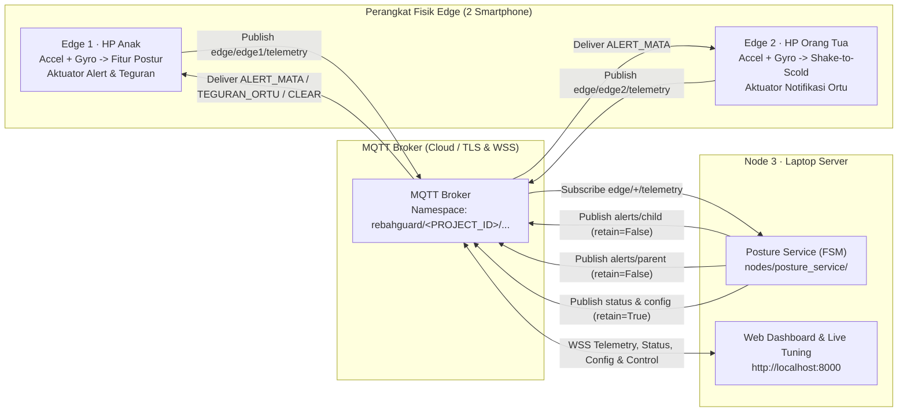
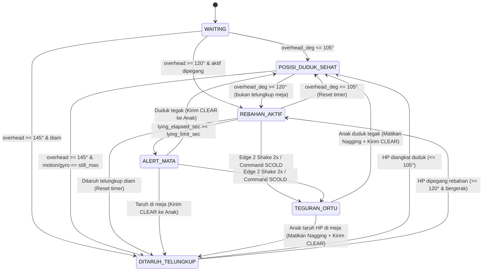

# RebahGuard: Sistem Pencegah Kebiasaan Main HP Sambil Rebahan Berbasis Multisensor & MQTT Dua Arah

**RebahGuard** adalah sistem Internet of Things (IoT) multisensor real-time untuk mencegah kebiasaan bermain smartphone sambil rebahan telentang yang berisiko merusak kesehatan mata (astenopia/miopia progresif), postur leher, dan berpotensi menjatuhkan HP ke wajah.

Sistem ini menggunakan **2 smartphone fisik sebagai Edge Node** (**Edge 1 — HP Anak** dan **Edge 2 — HP Orang Tua**), **3 tahap pengolahan sinyal bebas bias kalibrasi**, **Mesin Status Hingga (FSM) berhisteresis**, serta **komunikasi MQTT dua arah** dengan **Dashboard Web Eye-Care & Live Parameter Tuning**.

---

## 1. Masalah & Solusi RebahGuard

### Masalah pada Detektor Kemiringan Sederhana
1. **False Positive saat HP Ditaruh Telungkup di Meja**: Ketika HP diletakkan telungkup di meja ($\text{overhead\_deg} \approx 180^\circ$), sensor gravitasi melihat orientasi yang sama dengan orang yang sedang berbaring telentang menatap layar di atas wajah.
2. **Bias Kalibrasi Statis Akselerometer Smartphone**: Setiap perangkat HP memiliki offset pabrik sebesar $0.1\text{--}0.3\text{ m/s}^2$ dari konstanta $9.81\text{ m/s}^2$. Jika algoritma mengurangkan magnitudo akselerasi dengan konstanta $9.81$, HP yang diam di meja tetap terlihat "bergerak" ($\text{RMS} \approx 0.25\text{ m/s}^2$) sehingga gagal terdeteksi sebagai ditaruh di meja.
3. **False Positive saat Duduk Main Game Landscape**: Ketika anak duduk tegak tetapi memegang HP miring (*landscape*, $a_x \approx 9.81\text{ m/s}^2$), sudut *roll* mencapai $\sim 80^\circ$. Jika detektor langsung menghukum sudut *roll*, bermain game sambil duduk tegak akan memicu alarm palsu.

### Solusi RebahGuard
- **3-Stage Calibration-Free Feature Extraction**: Menggabungkan orientasi vektor gravitasi rata-rata (`overhead_deg`, `roll_deg`), simpangan baku magnitudo akselerasi terhadap rata-rata window $\bar{m}$ (*Mean-Centered Dynamic Motion RMS* yang menghasilkan `motion_rms = 0.0000` saat HP diam terlepas dari bias kalibrasi), serta *Gyroscope Micro-Activity RMS* (`gyro_rms`).
- **Diskriminasi Cerdas Meja vs Rebahan Aktif**: Jika $\text{overhead\_deg} \ge 145^\circ$ namun `motion_rms <= 0.05` dan `gyro_rms <= 0.015`, sistem mengenali state **`DITARUH_TELUNGKUP`** dan otomatis mematikan alarm/getaran.
- **Histeresis Sudut ($105^\circ\text{--}120^\circ$)**: Mencegah osilasi status ketika tangan sedikit bergoyang di sekitar ambang batas.
- **Interaksi Fisik Dua Arah (*Shake-to-Scold*)**: Saat durasi rebahan melewati batas (`ALERT_MATA`), HP Orang Tua (Edge 2) menerima notifikasi. Orang tua cukup **menggoyangkan HP-nya selama 2 window berturut-turut** (atau menekan tombol `SCOLD` di Dashboard) untuk memicu state **`TEGURAN_ORTU`** (getaran/nada peringatan berulang di HP Anak hingga anak duduk tegak atau menaruh HP).

---

## 2. Arsitektur Sistem 2 Arah



---

## 3. Tabel Sensor & 3 Tahap Data Processing (`shared/processing.py`)

Setiap window sensor ($\ge 2$ sampel, default 6 sampel @ $100\text{ ms}$) diproses melalui 3 tahap matematis di [`shared/processing.py`](shared/processing.py):

| Tahap | Nama Proses | Rumus Matematis | Output Fitur | Tujuan Fisik |
|---|---|---|---|---|
| **Processing A** | *Gravity Orientation Smoothing* | $\bar{\mathbf{a}} = (\bar{a}_x, \bar{a}_y, \bar{a}_z)$, $g_{\text{norm}} = \max(10^{-6}, \|\bar{\mathbf{a}}\|)$<br/>$\text{overhead\_deg} = \arccos(\text{clamp}(\bar{a}_z / g_{\text{norm}}, -1, 1))$<br/>$\text{roll\_deg} = \text{atan2}(\|\bar{a}_x\|, \sqrt{\bar{a}_y^2 + \bar{a}_z^2})$ | `overhead_deg` ($0^\circ\text{--}180^\circ$)<br/>`roll_deg` ($0^\circ\text{--}90^\circ$) | Mengukur sudut layar menghadap ke bawah/wajah (`overhead_deg > 120°` saat rebahan telentang) dengan meredam *jitter* sesaat. |
| **Processing B** | *Mean-Centered Dynamic Motion RMS* | $m_i = \sqrt{a_{x,i}^2 + a_{y,i}^2 + a_{z,i}^2}$, $\bar{m} = \frac{1}{N}\sum m_i$<br/>$\text{motion\_rms} = \sqrt{\frac{1}{N}\sum_{i=1}^N (m_i - \bar{m})^2}$ | `motion_rms` ($\text{m/s}^2$) | **Bebas bias kalibrasi $9.81\text{ m/s}^2$**: membedakan HP diam mutlak di meja (`0.0000`) vs dipegang tangan manusia (`> 0.05`) vs digoyang kuat (`>= 2.0`). |
| **Processing C** | *Gyroscope Micro-Activity RMS* | $\text{gyro\_rms} = \sqrt{\frac{1}{N}\sum_{i=1}^N (g_{x,i}^2 + g_{y,i}^2 + g_{z,i}^2)}$ | `gyro_rms` ($\text{rad/s}$) | Mendeteksi gerakan mikro pergelangan tangan saat mengetik/scroll sambil rebahan serta memvalidasi goyangan *Shake-to-Scold* di HP Ortu. |

---

## 4. Diagram Mesin Status Hingga (FSM `RebahDetector`)



---

## 5. Panduan Cepat Menjalankan Sistem

### Langkah 1 — Jalankan Server & Dashboard di Laptop (Node 3)
Pastikan terpasang **Python 3.10+**:

```bash
python -m pip install -r requirements.txt
cp .env.example .env
```

*(Di Windows PowerShell gunakan `Copy-Item .env.example .env`)*
Atur `PROJECT_ID` yang unik di `.env`, lalu jalankan:

```bash
python server.py
```

Buka **http://localhost:8000** di browser laptop. Dashboard otomatis memuat `PROJECT_ID` dan URL WSS broker dari `/config.json`.

### Langkah 2 — Jalankan Edge 1 (HP Anak) & Edge 2 (HP Orang Tua)

Anda dapat memilih **Opsi A (Browser HTTPS tanpa instal aplikasi)**, **Opsi B (Termux + Termux:API di Android)**, atau **kombinasi keduanya**:

#### Opsi A: Browser HP via HTTPS (`web-edge/index.html`)
1. Host folder `web-edge/` ke layanan statis HTTPS (seperti Netlify Drop / GitHub Pages / Cloudflare Pages).
2. Di **HP Anak**: pilih `Edge 1 — HP Anak`, samakan `PROJECT_ID`, centang **Invert Sumbu Z** jika memakai Safari iPhone, lalu tekan **Mulai membaca sensor**.
3. Di **HP Orang Tua**: pilih `Edge 2 — HP Orang Tua`, samakan `PROJECT_ID`, lalu tekan **Mulai membaca sensor**.

#### Opsi B: Android Fisik via Termux + Termux:API
Pada masing-masing HP Android:

```bash
# Di HP Anak (Edge 1):
python hp_anak.py

# Di HP Orang Tua (Edge 2):
python hp_ortu.py
```

### Langkah 3 — Mode Offline Demo & Unit Testing (Tanpa Internet)
Untuk memverifikasi seluruh transisi state FSM dan 29 unit test di laptop:

```bash
python -m unittest discover -s tests -v
python -m scripts.offline_demo
```

---

## 6. Panduan Live Parameter Tuning di Dashboard

Saat presentasi atau kalibrasi di permukaan meja yang berbeda:
1. Buka panel **"Mode Kalibrasi & Live Tuning Threshold (Tanpa Restart)"** di Dashboard (`http://localhost:8000`).
2. Letakkan HP Anak telungkup di meja dan amati kotak **Angka Mentah Sensor Terakhir** (`E1 motion_rms` dan `E1 gyro_rms`).
3. Untuk mempercepat demo video, ubah `lying_limit_sec` dari `10` menjadi `5` detik, lalu klik **Terapkan Threshold Live** (atau jalankan `python -m scripts.send_control --set-limit 5`).
4. Perubahan langsung berlaku secara *real-time* dan tersimpan *retained* pada topic `rebahguard/<PROJECT_ID>/config`.

---

## 7. Urutan Skenario Video Demo 2 Menit

1. **00:00 – 00:25 | Posisi Duduk Sehat & Main Game Landscape**:
   Anak memegang HP duduk tegak, lalu memiringkan HP *landscape* seperti bermain game. Tunjukkan Dashboard tetap hijau **`POSISI_DUDUK_SEHAT`** (tidak *false positive*).
2. **00:25 – 00:45 | HP Ditaruh Telungkup di Meja**:
   Anak meletakkan HP telungkup diam di meja. Meskipun sudut $\approx 180^\circ$, `motion_rms` mendekati `0.0000` sehingga Dashboard menampilkan **`DITARUH_TELUNGKUP`** (aman).
3. **00:45 – 01:15 | Rebahan Telentang hingga `ALERT_MATA`**:
   Anak mengangkat HP sambil rebahan telentang ($\text{overhead\_deg} \ge 120^\circ$). Progress bar durasi rebahan naik hingga melewati batas (`lying_limit_sec`), memicu **`ALERT_MATA`** beserta getaran/notifikasi di HP Anak dan HP Orang Tua.
4. **01:15 – 01:40 | Interaksi *Shake-to-Scold* (`TEGURAN_ORTU`)**:
   Orang tua menggoyangkan HP Edge 2 selama 2 window berturut-turut. Status berubah menjadi **`TEGURAN_ORTU`**, dan HP Anak bergetar/berbunyi berulang kali.
5. **01:40 – 02:00 | Anak Kembali Duduk Tegak (`CLEAR`)**:
   Anak kembali duduk tegak (atau menaruh HP telungkup di meja). Status kembali ke **`POSISI_DUDUK_SEHAT`**, event **`CLEAR`** dikirim otomatis ke HP Anak, dan alarm berhenti seketika.

---

## Dokumentasi Lengkap
- [Arsitektur & Topik MQTT](docs/ARCHITECTURE.md)
- [Penjelasan Fisika Sensor, Rumus & FSM](docs/LEARNING.md)
- [Panduan Browser HTTPS (iOS & Android)](docs/BROWSER_EDGE.md)
- [Panduan Android Termux:API](docs/ANDROID.md)
- [Panduan Dashboard & Live Tuning](docs/DASHBOARD.md)
- [Konfigurasi Broker MQTT](docs/SETUP.md)
- [Keamanan Siber & Anti-Replay](docs/SECURITY.md)
- [Sensor Playground](docs/SENSOR_PLAYGROUND.md)
