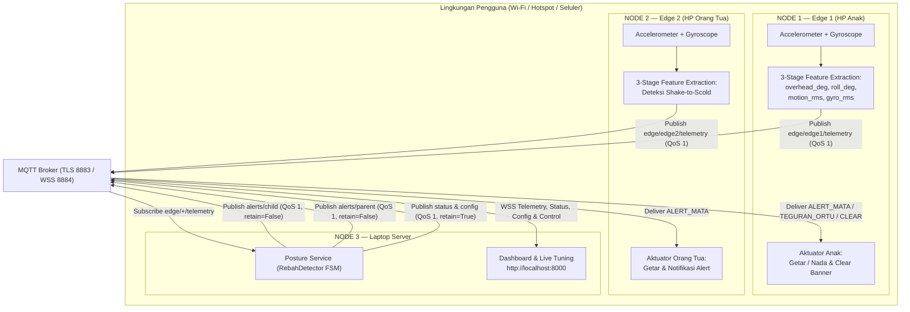
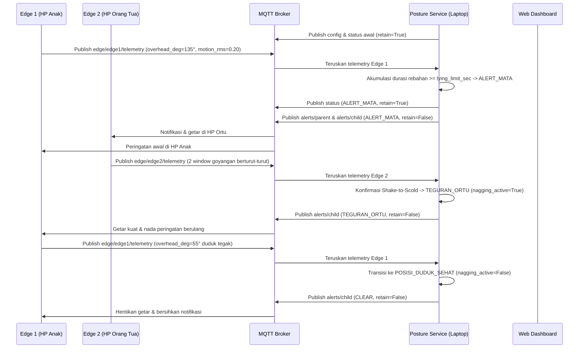

# Arsitektur Sistem IoT RebahGuard

Sistem **RebahGuard** terdiri dari **tiga node utama** yang berjalan pada **tiga perangkat fisik terpisah**: dua smartphone sebagai *edge node* (sensor + aktuator dua arah) dan satu laptop sebagai *posture service* sekaligus pelayan *web dashboard* lokal.

## Peran Setiap Node

| Node | Perangkat | Input Sensor | Pemrosesan Lokal | Output & Aktuasi |
|---|---|---|---|---|
| **Edge 1 (`hp_anak.py` / `web-edge`)** | Smartphone Anak | Accelerometer + Gyroscope | Orientasi gravitasi (`overhead_deg`, `roll_deg`), *mean-centered* `motion_rms`, `gyro_rms` | Publish `edge/edge1/telemetry`; terima `alerts/child` (`ALERT_MATA`, `TEGURAN_ORTU`, `CLEAR`) |
| **Edge 2 (`hp_ortu.py` / `web-edge`)** | Smartphone Orang Tua | Accelerometer + Gyroscope | Ekstraksi `motion_rms` & `gyro_rms` untuk fitur *Shake-to-Scold* | Publish `edge/edge2/telemetry`; terima `alerts/parent` (`ALERT_MATA`) |
| **Posture Service (`server.py`)** | Laptop | Telemetry dari kedua edge & perintah `control` | FSM `RebahDetector` berhisteresis, anti-stale, anti-replay, *shake confirmation* | Publish `status` (retained), `config` (retained), `alerts/parent` & `alerts/child` (non-retained) |
| **Dashboard (`dashboard/index.html`)** | Browser Laptop | `status`, `config`, `edge/+/telemetry`, `alerts/+` | Visualisasi real-time & validasi parameter kalibrasi | Grafik histeresis, tombol `SCOLD`/`SNOOZE`/`RESET`/`ARM`, & `UPDATE_CONFIG` live |

## Alur Komunikasi Dua Arah (Sequence Diagram)

